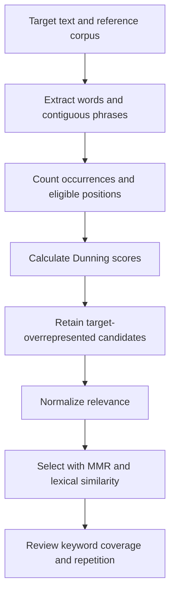

# Keyword Extraction With Dunning’s Log-Likelihood and MMR

> **CURRENT — learning and implementation guide**  
> **Goal:** extract words and phrases that distinguish a target text from a reference corpus, then select a less repetitive subset.  
> **Scope:** words and contiguous two-word phrases, with measured lexical similarity. Semantic embeddings and summarization are outside this example.  
> **Quick start:** budget 10–15 minutes to read and run the example.  
> **Validation status:** automated checks are included, but execution has not been verified in this session.

## 1. Design Choice

**Candidate approaches:** rank candidates by statistical distinctiveness alone, or apply MMR afterward to penalize repetition.

**Discriminating evidence:** corpus counts establish statistical distinctiveness; pairwise similarity establishes the redundancy penalty. Neither establishes usefulness to a reader by itself. [empirical:cited, sources 1–2]

**Premises:**
- [observed] **Dunning’s method** → compares → shared versus separate occurrence probabilities. [empirical:cited, source 1]
- [observed] **MMR** → balances → relevance and similarity to selected items. [empirical:cited, source 2]

**Conclusion:** use Dunning to score candidates, a direction filter to retain target-overrepresented candidates, and MMR to diversify the selection.

## 2. What Each Component Does

| Component | Question it answers | Input | Output |
|---|---|---|---|
| Candidate extraction | Which words and phrases occur? | Target and background text | Counts and eligible positions |
| Dunning’s log-likelihood | Do occurrence rates differ? | Counts and corpus sizes | Statistical distinctiveness scores |
| Direction filter | Is the candidate more common in the target? | Target and background rates | Overrepresented candidates |
| Similarity | How much do two candidates overlap? | Candidate strings | Pairwise similarity |
| MMR | Which candidate balances relevance with reduced repetition? | Scores and similarities | Ordered selection |

*[empirical:cited, sources 1–2 and implementation below]*

**Statistical distinctiveness is not semantic importance.** A candidate can distinguish two corpora without being useful to a reader. [empirical:cited, scope of the likelihood-ratio calculation in source 1]

## 3. Dunning’s Log-Likelihood

For each candidate, collect:

| | Target corpus | Background corpus |
|---|---:|---:|
| Candidate occurrences | k1 | k2 |
| Other eligible positions | n1 − k1 | n2 − k2 |

For words, the eligible positions are token positions. For phrases, this implementation uses positions where a phrase of that length could begin without crossing a punctuation boundary. [empirical:cited, implementation below]

### The Two Hypotheses

- **Null hypothesis:** the candidate has the same occurrence probability in both corpora.
- **Alternative hypothesis:** its occurrence probabilities differ.

The test compares how well these models explain the observed counts. Larger G² values indicate greater disagreement with the shared-probability model. [empirical:cited, source 1]

**G² is unsigned.** To retain only target-overrepresented candidates, compare their occurrence rates separately:

`retain_candidate = target_count * background_total > background_count * target_total`

This is equivalent to comparing the two rates without dividing. [empirical:cited, algebraic derivation]

### Why Zipf Matters

**Zipf’s law** describes an approximate relationship between word frequency and frequency rank: a few words occur very often, while many words occur rarely. [empirical:cited, source 3]

A rough description is:

`frequency ≈ constant / rank`

The resulting rare-word counts make statistical approximation important. Pearson’s chi-squared test does **not** require normally distributed word frequencies; small expected cell counts are the relevant concern for its asymptotic approximation. [empirical:cited, source 1]

Dunning’s likelihood-ratio approach addresses problems with conventional approximations for sparse language data. It does not make every rare-word result reliable. [empirical:cited, source 1]

### Information-Theory Connection

For a contingency table, G² can be expressed using KL divergence or empirical mutual information:

`G² = 2 * total_positions * mutual_information`

Here, mutual information measures the empirical association between **corpus identity** and **candidate occurrence**, using natural logarithms. The equivalent KL divergence compares the empirical joint distribution with its independence model. [empirical:cited, contingency-table likelihood-ratio identity]

This is a statistical information measure, not a direct measurement of how informative a phrase is to a person.

### Worked G² Calculation

Use “information” from the sample:

| | Target | Background | Total |
|---|---:|---:|---:|
| “information” | 4 | 0 | 4 |
| Other tokens | 6 | 16 | 22 |
| Total | 10 | 16 | 26 |

Under the shared-probability hypothesis:

`pooled_probability = 4 / 26 ≈ 0.153846`

Each expected count is calculated as:

`expected = row_total * column_total / grand_total`

| | Target expected | Background expected |
|---|---:|---:|
| “information” | 1.538462 | 2.461538 |
| Other tokens | 8.461538 | 13.538462 |

The contingency-table formula is:

`G² = 2 * sum(observed * ln(observed / expected))`

A cell with zero observations contributes zero, using the limiting value of the expression. [empirical:cited, source 1 and independence-model derivation]

Substitute the nonzero cells:

`G² = 2 * [4 * ln(4 / 1.538462) + 6 * ln(6 / 8.461538) + 16 * ln(16 / 13.538462)]`

**Result: approximately 8.864564.** This is a worked arithmetic result, not a reported runtime result. [empirical:cited, displayed counts and formula]

The target occurrence rate is 0.4, versus 0 in the background, so the direction filter retains the word. [empirical:cited, displayed counts]

### Interpretation Limits

- **G²** measures evidence against equal rates, not effect size or semantic usefulness. Corpus size affects the score. [empirical:cited, source 1]
- **A zero background count** means the candidate was not observed in that sample, not that it is absent from the language. [empirical:cited, sampling interpretation of the count model]
- **Overlapping phrase windows** are not independent observations. This example uses phrase G² values for ranking, not calibrated significance testing. [empirical:cited, overlapping-window mechanism below]

## 4. MMR: Relevance Minus Redundancy

MMR selects candidates one at a time. At each step after the initial selection, it evaluates:

`mmr_score = lambda * relevance - (1 - lambda) * maximum_similarity_to_selected`

| Term | Meaning in this implementation |
|---|---|
| Relevance | Normalized Dunning score |
| Maximum similarity | Highest lexical similarity to an already selected candidate |
| Lambda | Relevance–redundancy tradeoff, between 0 and 1 |

Larger lambda values favor relevance; smaller values give the redundancy penalty more influence. MMR penalizes similarity but does not guarantee distinct concepts or complete topic coverage. [empirical:cited, source 2]

The first candidate is selected by relevance because there are no previously selected candidates to compare against. This implementation uses that initialization even when lambda is zero. [empirical:cited, implementation below]

### Why Normalize Relevance?

Raw G² scores and bounded similarity scores can have substantially different scales. Combining them directly can make lambda difficult to interpret. [empirical:cited, G² definition and MMR equation]

This implementation uses:

`normalized_relevance = score / maximum_score`

For a positive maximum, this preserves relevance ordering and places scores between 0 and 1. It is a design choice, not a requirement of MMR; equal ranges do not guarantee equally distributed scores. [empirical:cited, normalization definition]

## 5. Phrase Extraction and Similarity

### Contiguous Phrase Candidates

The extractor generates words and two-word phrases:

| Text | Word candidates | Phrase candidates |
|---|---|---|
| “information theory” | “information”, “theory” | “information theory” |
| “neural network model” | “neural”, “network”, “model” | “neural network”, “network model” |

Punctuation and line breaks separate segments, so phrases do not cross those boundaries. Contiguous phrases are candidates, not guaranteed meaningful expressions. [empirical:cited, extraction mechanism below]

### Measured Lexical Similarity

The similarity function represents each candidate as counts of overlapping character trigrams, then calculates cosine similarity between the resulting vectors. [empirical:cited, implementation below]

For example, “information” and “information theory” share character features. “Car” and “automobile” may share little despite their semantic relationship. [empirical:cited, character-overlap mechanism]

**Lexical similarity is real, calculated similarity—but not semantic similarity.** An embedding model is a separate extension if the requirement is to penalize differently worded expressions of the same concept.

## 6. Implementation Contract

**Spec layer: Requirements and Behavioral**, because extraction, score scaling, and selection order determine observable output.

| Contract | Required behavior |
|---|---|
| Tokenization | Lowercase alphanumeric words; punctuation separates segments |
| Phrase extraction | Contiguous n-grams; default to words and two-word phrases |
| Corpus validation | Reject corpora without tokens |
| Counting denominator | Use eligible positions for each candidate length |
| Missing phrase opportunities | Skip lengths with no background opportunities |
| Candidate filtering | Retain only target-overrepresented candidates |
| Likelihood calculation | Handle zero counts without probability clipping |
| Relevance scaling | Divide by the largest positive score |
| Similarity | Character-trigram cosine similarity, bounded to 0–1 |
| MMR selection | Highest relevance first, then maximum-similarity penalties |
| Parameter validation | Finite scores, valid lambda, nonnegative integer selection count |
| Boundaries | Empty selection for no candidates or zero selection count |
| Tie handling | Alphabetical |
| Validation | Separate checks for extraction, scoring, similarity, and selection |

Words and phrases have different opportunity totals. Combining their scores is an explicit ranking choice, not a demonstrated guarantee of fair comparison across candidate lengths. [empirical:cited, denominator definitions below]

## 7. Runnable Python Example

**Dependencies:** Python 3.10 or later; standard library only.

Save as `keyword_mmr.py`, then run `python keyword_mmr.py`. The script runs its checks before printing the example; failed checks stop execution.

```python
import math
import re
import unittest
from collections import Counter
from typing import Callable


def get_word_counts(
    text: str,
    ngram_range: tuple[int, int] = (1, 2),
) -> tuple[Counter, dict[int, int]]:
    """Count words and contiguous phrases with per-length opportunity totals.

    Requires a string and integer bounds satisfying 1 <= lower <= upper.
    Punctuation and line breaks separate segments; phrases cannot cross them.
    Returns empty counts for text without alphanumeric tokens.
    """
    lower, upper = ngram_range
    if type(lower) is not int or type(upper) is not int:
        raise ValueError("N-gram bounds must be integers.")
    if not 1 <= lower <= upper:
        raise ValueError("Require 1 <= lower <= upper.")

    counts = Counter()
    opportunities = {length: 0 for length in range(lower, upper + 1)}
    segments = re.split(r"[^\w\s]|_|\n|\r", text.lower())

    for segment in segments:
        words = re.findall(r"[^\W_]+", segment)

        for length in opportunities:
            positions = max(0, len(words) - length + 1)
            opportunities[length] += positions

            for start in range(positions):
                candidate = " ".join(words[start:start + length])
                counts[candidate] += 1

    return counts, opportunities


def log_likelihood_function(k: int, n: int, p: float) -> float:
    """Return binomial log-likelihood without its combinatorial constant.

    Requires integer counts with 0 <= k <= n and finite p in [0, 1].
    Zero-count terms contribute zero; impossible events return negative infinity.
    Invalid arguments raise ValueError.
    """
    if type(k) is not int or type(n) is not int or not 0 <= k <= n:
        raise ValueError("Require integer counts with 0 <= k <= n.")
    if not math.isfinite(p) or not 0.0 <= p <= 1.0:
        raise ValueError("Probability must be finite and between 0 and 1.")

    successes = 0.0
    failures = 0.0

    if k:
        if p == 0.0:
            return -math.inf
        successes = k * math.log(p)

    if n - k:
        if p == 1.0:
            return -math.inf
        failures = (n - k) * math.log1p(-p)

    return successes + failures


def calculate_dunning_scores(
    target: str,
    background: str,
    ngram_range: tuple[int, int] = (1, 2),
) -> dict[str, float]:
    """Score target-overrepresented words and phrases using G².

    Requires both corpora to contain tokens and valid n-gram bounds.
    Each length uses its own opportunity total. Lengths without background
    opportunities are skipped rather than compared against an empty sample.
    Returns finite nonnegative ranking scores; raises ValueError for empty text.
    """
    target_counts, target_totals = get_word_counts(target, ngram_range)
    background_counts, background_totals = get_word_counts(
        background, ngram_range
    )

    if not re.search(r"[^\W_]", target) or not re.search(r"[^\W_]", background):
        raise ValueError("Target and background must both contain tokens.")

    scores = {}

    for candidate, k1 in target_counts.items():
        length = len(candidate.split())
        n1 = target_totals[length]
        n2 = background_totals[length]
        k2 = background_counts.get(candidate, 0)

        if n2 == 0:
            continue
        if k1 * n2 <= k2 * n1:
            continue

        pooled_p = (k1 + k2) / (n1 + n2)
        alternative = (
            log_likelihood_function(k1, n1, k1 / n1)
            + log_likelihood_function(k2, n2, k2 / n2)
        )
        null = (
            log_likelihood_function(k1, n1, pooled_p)
            + log_likelihood_function(k2, n2, pooled_p)
        )

        raw_score = 2.0 * (alternative - null)
        assert math.isfinite(raw_score)
        assert raw_score >= -1e-10
        scores[candidate] = max(0.0, raw_score)

    return scores


def lexical_similarity(candidate1: str, candidate2: str) -> float:
    """Calculate cosine similarity between character-trigram count vectors.

    Requires nonempty candidate strings.
    Returns a value in [0, 1]. Measures spelling overlap, not semantic equivalence;
    differently spelled synonyms may receive low similarity.
    """
    vectors = []

    for candidate in (candidate1, candidate2):
        normalized = " ".join(candidate.lower().split())
        if not normalized:
            raise ValueError("Similarity requires nonempty candidates.")

        padded = f"  {normalized}  "
        vectors.append(
            Counter(
                padded[start:start + 3]
                for start in range(len(padded) - 2)
            )
        )

    left, right = vectors
    dot_product = sum(
        value * right.get(key, 0)
        for key, value in left.items()
    )
    left_norm = math.sqrt(sum(value * value for value in left.values()))
    right_norm = math.sqrt(sum(value * value for value in right.values()))

    similarity = dot_product / (left_norm * right_norm)
    assert math.isfinite(similarity)
    return min(1.0, max(0.0, similarity))


def rank_mmr(
    relevance_scores: dict[str, float],
    lambda_param: float = 0.5,
    top_k: int = 3,
    similarity: Callable[[str, str], float] = lexical_similarity,
) -> list[str]:
    """Select candidates using normalized relevance and redundancy penalties.

    Requires finite nonnegative scores, lambda in [0, 1], nonnegative integer
    top_k, and evaluated similarity values in [0, 1].
    Returns unique candidates in selection order; ties resolve alphabetically.
    Invalid parameters or evaluated similarities raise ValueError.
    """
    if not math.isfinite(lambda_param) or not 0.0 <= lambda_param <= 1.0:
        raise ValueError("lambda_param must be finite and between 0 and 1.")
    if type(top_k) is not int or top_k < 0:
        raise ValueError("top_k must be a nonnegative integer.")
    if any(
        not math.isfinite(score) or score < 0.0
        for score in relevance_scores.values()
    ):
        raise ValueError("Relevance scores must be finite and nonnegative.")

    if not relevance_scores or top_k == 0:
        return []

    maximum = max(relevance_scores.values())
    relevance = {
        candidate: score / maximum if maximum > 0.0 else 0.0
        for candidate, score in relevance_scores.items()
    }

    remaining = sorted(relevance)
    first = max(remaining, key=relevance.__getitem__)
    selected = [first]
    remaining.remove(first)

    while remaining and len(selected) < top_k:
        candidate_scores = {}

        for candidate in remaining:
            values = [similarity(candidate, item) for item in selected]
            if any(
                not math.isfinite(value) or not 0.0 <= value <= 1.0
                for value in values
            ):
                raise ValueError(
                    "Similarity must be finite and between 0 and 1."
                )

            candidate_scores[candidate] = (
                lambda_param * relevance[candidate]
                - (1.0 - lambda_param) * max(values)
            )

        chosen = max(remaining, key=candidate_scores.__getitem__)
        selected.append(chosen)
        remaining.remove(chosen)

    assert len(selected) == len(set(selected))
    assert len(selected) <= top_k
    return selected


class KeywordTests(unittest.TestCase):
    """Validate extraction, scoring, similarity, and MMR independently.

    Uses fixed synthetic fixtures and no external models.
    Assertion failures prevent acceptance of the implementation.
    """

    def test_phrase_extraction(self):
        cases = (
            (
                "Oak pine. Oak!",
                Counter({"oak": 2, "pine": 1, "oak pine": 1}),
                {1: 3, 2: 1},
            ),
            (
                "Red blue green",
                Counter({
                    "red": 1,
                    "blue": 1,
                    "green": 1,
                    "red blue": 1,
                    "blue green": 1,
                }),
                {1: 3, 2: 2},
            ),
            (
                "North\nsouth",
                Counter({"north": 1, "south": 1}),
                {1: 2, 2: 0},
            ),
        )
        for text, expected_counts, expected_totals in cases:
            with self.subTest(text=text):
                counts, totals = get_word_counts(text)
                self.assertEqual(counts, expected_counts)
                self.assertEqual(totals, expected_totals)

    def test_known_g_squared_values(self):
        cases = (
            ("a a", "b b", "a", 8.0 * math.log(2.0)),
            ("a b", "c d", "a", 1.726092434710685),
            (
                "a a a a b b b b b b",
                " ".join(["c"] * 16),
                "a",
                8.864563812044447,
            ),
        )
        for target, background, candidate, expected in cases:
            with self.subTest(target=target):
                scores = calculate_dunning_scores(
                    target, background, (1, 1)
                )
                self.assertAlmostEqual(
                    scores[candidate], expected, places=8
                )

    def test_phrase_scoring(self):
        cases = (
            ("oak pine", "red blue"),
            ("north south", "east west"),
            ("solar panel", "river bank"),
        )
        for target, background in cases:
            with self.subTest(target=target):
                scores = calculate_dunning_scores(
                    target, background, (2, 2)
                )
                self.assertEqual(set(scores), {target})
                self.assertAlmostEqual(
                    scores[target], 4.0 * math.log(2.0)
                )

    def test_direction_filter(self):
        cases = (
            ("oak pine", "oak pine"),
            ("red red blue", "red red blue red red blue"),
            ("one", "one one one"),
        )
        for target, background in cases:
            with self.subTest(target=target):
                self.assertEqual(
                    calculate_dunning_scores(
                        target, background, (1, 1)
                    ),
                    {},
                )

    def test_lexical_similarity(self):
        cases = (
            ("climate", "climate policy", "volcano"),
            ("neural", "neural network", "orchard"),
            ("solar", "solar panel", "bicycle"),
        )
        for word, phrase, unrelated in cases:
            with self.subTest(word=word):
                self.assertAlmostEqual(
                    lexical_similarity(word, word), 1.0
                )
                self.assertGreater(
                    lexical_similarity(word, phrase),
                    lexical_similarity(word, unrelated),
                )
                self.assertAlmostEqual(
                    lexical_similarity(word, phrase),
                    lexical_similarity(phrase, word),
                )

    def test_mmr_with_measured_similarity(self):
        cases = (
            ("climate", "climate policy", "volcano"),
            ("neural", "neural network", "orchard"),
            ("solar", "solar panel", "bicycle"),
        )
        for first, related, distinct in cases:
            scores = {first: 10.0, related: 9.0, distinct: 8.0}
            with self.subTest(first=first):
                self.assertEqual(
                    rank_mmr(scores, 1.0, 2), [first, related]
                )
                self.assertEqual(
                    rank_mmr(scores, 0.4, 2), [first, distinct]
                )

    def test_boundaries(self):
        self.assertEqual(rank_mmr({}), [])
        self.assertEqual(rank_mmr({"oak": 1.0}, top_k=0), [])
        self.assertEqual(
            rank_mmr({"oak": 1.0}, top_k=10), ["oak"]
        )

    def test_empty_corpora(self):
        cases = (("", "oak"), ("oak", ""), ("!", "?"))
        for target, background in cases:
            with self.subTest(target=target, background=background):
                with self.assertRaises(ValueError):
                    calculate_dunning_scores(target, background)

    def test_invalid_lambda(self):
        for value in (-0.1, 1.1, math.nan):
            with self.subTest(value=value):
                with self.assertRaises(ValueError):
                    rank_mmr({"oak": 1.0}, lambda_param=value)

    def test_invalid_similarity(self):
        for value in (-0.1, 1.1, math.nan):
            def similarity(left: str, right: str) -> float:
                """Return the fixture value to test interface validation."""
                return value

            with self.subTest(value=value):
                with self.assertRaises(ValueError):
                    rank_mmr(
                        {"oak": 2.0, "pine": 1.0},
                        top_k=2,
                        similarity=similarity,
                    )


def main() -> None:
    """Run local checks before demonstrating word-and-phrase selection.

    Requires Python 3.10+ and no third-party packages.
    Failed checks terminate execution before the demonstration.
    """
    suite = unittest.defaultTestLoader.loadTestsFromTestCase(
        KeywordTests
    )
    result = unittest.TextTestRunner(verbosity=2).run(suite)
    if not result.wasSuccessful():
        raise SystemExit(1)

    target_text = (
        "information theory information theory entropy "
        "dunning keywords keywords information information"
    )
    background_text = (
        "the quick brown fox jumps over the lazy dog "
        "machine learning deep learning data science"
    )

    scores = calculate_dunning_scores(
        target_text, background_text
    )

    print("\n--- Word and Phrase G² Scores ---")
    for candidate, score in sorted(
        scores.items(), key=lambda item: (-item[1], item[0])
    ):
        print(f"{candidate}: {score:.6f}")

    print("\n--- MMR: relevance only ---")
    print(rank_mmr(scores, lambda_param=1.0, top_k=5))

    print("\n--- MMR: lexical redundancy penalty ---")
    print(rank_mmr(scores, lambda_param=0.4, top_k=5))


if __name__ == "__main__":
    main()
```

## 8. How to Read the Example

### Dunning Stage

The sample target contains four occurrences of “information,” two each of “theory” and “keywords,” and one each of “entropy” and “dunning.” None appears in the background. [empirical:cited, sample text]

The extractor also generates phrases such as “information theory.” Their scores use bigram opportunity totals rather than word totals. [empirical:cited, implementation]

Because the background has no vocabulary overlap with the target, this example demonstrates the mechanism rather than performance against a representative reference corpus.

### MMR Stage

Compare the two printed selections:

- **Lambda 1.0:** relevance-only selection.
- **Lambda 0.4:** relevance with a lexical redundancy penalty.

A phrase sharing character features with a selected word receives a penalty. The code does not hard-code semantic relationships among “information,” “theory,” and “entropy.” [empirical:cited, implementation]

A changed ordering demonstrates that the penalty affects selection. It does not establish that the resulting keywords are better.

## 9. End-to-End Workflow



## 10. Moving Beyond the Example

| Current implementation | Possible extension | Purpose |
|---|---|---|
| Small unrelated background | Representative reference corpus | Make the comparison relevant to the task |
| Alphanumeric tokenization | Domain-aware tokenizer | Handle technical tokens and language-specific boundaries |
| Contiguous n-grams | Linguistic noun-phrase extraction | Restrict candidates to more meaningful phrase structures |
| Unfiltered vocabulary | Explicit stopword and frequency policies | Control unwanted candidates |
| Character-trigram similarity | Semantic embedding similarity | Compare differently worded concepts |
| Keyword selection | Separate sentence-selection pipeline | Support extractive summarization |

These are proposed extensions, not demonstrated improvements for a particular dataset. [colloquial]

**Embedding interface:** this MMR function accepts a similarity callback, so an embedding-based implementation can replace lexical similarity without duplicating selection logic. [empirical:cited, function signature]

Cosine similarity can be negative. An embedding replacement must explicitly transform its values into the required 0–1 range or revise the interface contract. [empirical:cited, cosine definition and validation code]

**Summarization boundary:** selecting keywords or keyphrases does not generate a text summary. Sentence extraction, scoring, and selection require their own contracts.

## 11. Bounded Validation

### OPEN: Execution Verification

No execution tool was available when this copy was prepared. The tests are supplied, not reported as passed.

1. **Extraction and scoring — budget 3 minutes:** run `python keyword_mmr.py`; inspect the extraction, phrase-scoring, and numerical G² checks.
2. **Similarity and selection — budget 3 minutes:** inspect the similarity and MMR checks, each covering three varied fixtures.
3. **Small real-text review — budget 5 minutes:** replace the sample corpora and compare relevance-only versus diversified selections.

If candidate quality is poor before MMR, inspect tokenization and the reference corpus first. MMR can only select from the candidates it receives. [empirical:cited, pipeline dependencies]

### Acceptance Checklist

- [ ] Script exits successfully and all included tests pass.
- [ ] Word and phrase candidates appear in the scored output.
- [ ] Numerical G² fixtures match their expected values.
- [ ] Equal-rate candidates are excluded.
- [ ] Lexical similarity is symmetric and bounded.
- [ ] MMR returns unique candidates and respects the selection limit.
- [ ] A small real-text review finds useful candidates.
- [ ] Remaining redundancy is acceptable for the intended use.

Passing the automated checks verifies those tested contracts in the local environment. It does not establish semantic quality or calibrated significance for overlapping phrases.

## Sources

1. Dunning, T. (1993). [*Accurate Methods for the Statistics of Surprise and Coincidence*](https://aclanthology.org/J93-1003/).
2. Carbonell, J., & Goldstein, J. (1998). [*The Use of MMR, Diversity-Based Reranking for Reordering Documents and Producing Summaries*](https://doi.org/10.1145/290941.291025).
3. Zipf, G. K. (1949). *Human Behavior and the Principle of Least Effort*. Addison-Wesley.

**Sprawl review: nothing to collapse.**