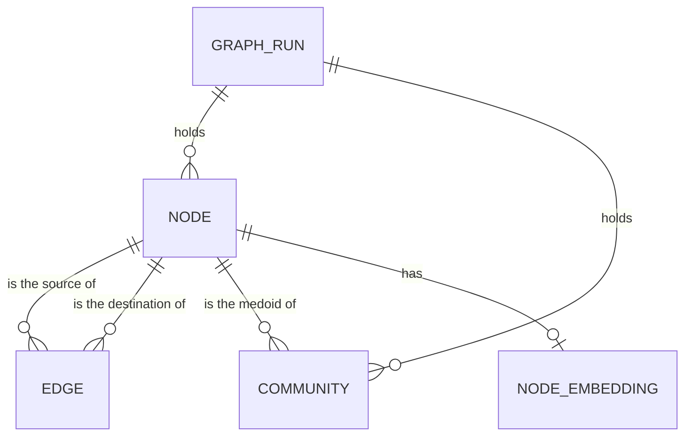

# Entity Model: Chunk Graph

The chunk graph of a corpus: each run holds its chunks, the connections between them, their communities and their embeddings.

## Entity Relationship Diagram

### GRAPH_RUN

One build of a chunk graph under a label.

| Attribute | Description | Data Type | Length/Precision | Validation Rules |
|---|---|---|---|---|
| run_id | Unique identifier of the run | String | - | Primary Key, Sequence |
| label | Label the run was built under | String | - | Not Null |
| ingested_at | When the run was stored | DateTime | - | Not Null |
| n_chunks | Number of chunks in the run | Integer | 10 | Not Null, Min: 10 |
| embed_dim | Dimension of the chunk embeddings; empty when the run has none | Integer | 10 | Optional |
| params | Settings the run was built with, as a JSON document | String | - | Not Null |
| diagnostics | Measurements taken during the build, as a JSON document | String | - | Not Null |
| superseded_at | When a later run under the same label replaced this run | DateTime | - | Optional |

#### Constraints

- At most one run per label is live: the run with no superseded time.

### NODE

One chunk of a run.

| Attribute | Description | Data Type | Length/Precision | Validation Rules |
|---|---|---|---|---|
| run_id | Run the chunk belongs to | String | - | Primary Key, Foreign Key (GRAPH_RUN.run_id) |
| ord | Position of the chunk in the run | Integer | 10 | Primary Key |
| doc_id | Identifier of the source document | String | - | Not Null |
| chunk_hash | Binary content: stable identity of the chunk text, the same across runs | String | - | Not Null |
| body | Text of the chunk | String | - | Not Null |
| attrs | Source, title and other chunk properties, as a JSON document | String | - | Not Null |

### EDGE

A connection between two chunks of a run, with the kind of similarity that found it.

| Attribute | Description | Data Type | Length/Precision | Validation Rules |
|---|---|---|---|---|
| run_id | Run the connection belongs to | String | - | Primary Key, Foreign Key (NODE.run_id) |
| src | Earlier chunk of the pair | Integer | 10 | Primary Key, Foreign Key (NODE.ord) |
| dst | Later chunk of the pair | Integer | 10 | Primary Key, Foreign Key (NODE.ord) |
| provenance | Kind of similarity that found the connection | String | - | Not Null, Values: sparse, dense, both |
| strength | Strength of the connection on the fused scale | Decimal | - | Not Null |
| sim_sparse | Similarity by shared wording | Decimal | - | Not Null |
| sim_dense | Similarity by meaning; empty when the run has no embedding model | Decimal | - | Optional |
| src_doc | Source document of the earlier chunk | String | - | Not Null |
| dst_doc | Source document of the later chunk | String | - | Not Null |
| attrs | Source pair and other properties, as a JSON document | String | - | Not Null |
| valid_from | When the connection became valid | DateTime | - | Not Null |
| valid_to | When the connection was superseded; empty while it is live | DateTime | - | Optional |
| ingested_at | When the connection was stored | DateTime | - | Not Null |

#### Constraints

- Each pair is stored once with the earlier chunk first.
- The valid-to time is empty or not earlier than the valid-from time.

### COMMUNITY

A group of chunks of a run, named by its distinctive terms.

| Attribute | Description | Data Type | Length/Precision | Validation Rules |
|---|---|---|---|---|
| run_id | Run the community belongs to | String | - | Primary Key, Foreign Key (GRAPH_RUN.run_id) |
| cid | Community number, unique within the run | Integer | 10 | Primary Key |
| members | Positions of the chunks in the community, as a list | String | - | Not Null |
| size | Number of members | Integer | 10 | Not Null |
| keywords | Most distinctive terms of the community | String | - | Not Null |
| medoid | Position of the chunk closest to the community's centre | Integer | 10 | Not Null, Foreign Key (NODE.ord) |
| medoid_text | Text of the medoid chunk | String | - | Optional |
| attrs | Additional community properties, as a JSON document | String | - | Not Null |

### NODE_EMBEDDING

The embedding vector of a chunk, present only when the run has an embedding model.

| Attribute | Description | Data Type | Length/Precision | Validation Rules |
|---|---|---|---|---|
| run_id | Run the embedding belongs to | String | - | Primary Key, Foreign Key (NODE.run_id) |
| ord | Position of the chunk | Integer | 10 | Primary Key, Foreign Key (NODE.ord) |
| embedding | Dense embedding vector of the chunk; its dimension is the run's embed dimension | String | - | Not Null |
