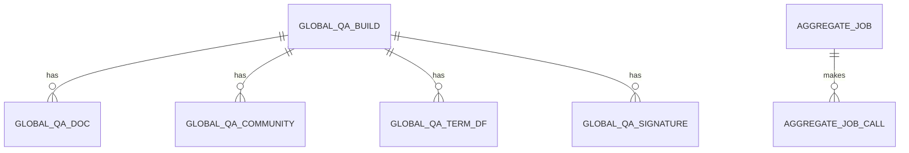

# Entity Model: Global Aggregate

The term counts per community that answer corpus-wide questions, and the durable jobs that classify sampled papers. The counts are stored in the graph database; the jobs are stored in a local job file.

## Entity Relationship Diagram

### GLOBAL_QA_BUILD

One complete term-count index, built from one section build.

| Attribute | Description | Data Type | Length/Precision | Validation Rules |
|---|---|---|---|---|
| qa_build_id | Unique identifier of the index | Long | 19 | Primary Key, Sequence |
| source_build_id | Section build the index was counted from; no foreign key is declared | Long | 19 | Not Null |
| tokenizer_version | Version of the tokenizer the terms were produced with | String | - | Not Null |
| signature_top_k | Number of routing terms kept per community | Integer | 10 | Not Null, Min: 1 |
| n_docs | Number of papers in the index | Integer | 10 | Not Null, Min: 0 |
| complete | Whether every count is stored | Boolean | - | Not Null |
| created_at | When the index was created | DateTime | - | Not Null |

### GLOBAL_QA_DOC

The paper assignment of each paper in an index.

| Attribute | Description | Data Type | Length/Precision | Validation Rules |
|---|---|---|---|---|
| qa_build_id | Index the paper belongs to | Long | 19 | Primary Key, Foreign Key (GLOBAL_QA_BUILD.qa_build_id) |
| paper_id | Identifier of the paper, without its version or method suffix | String | - | Primary Key |
| community_id | Community the paper belongs to | Integer | 10 | Not Null |
| text_sha256 | Hexadecimal digest of the paper's text, used to check the source | String | - | Not Null |

### GLOBAL_QA_COMMUNITY

The number of papers in each community of an index.

| Attribute | Description | Data Type | Length/Precision | Validation Rules |
|---|---|---|---|---|
| qa_build_id | Index the community belongs to | Long | 19 | Primary Key, Foreign Key (GLOBAL_QA_BUILD.qa_build_id) |
| community_id | Community number | Integer | 10 | Primary Key |
| n_docs | Number of papers in the community | Integer | 10 | Not Null, Min: 1 |

### GLOBAL_QA_TERM_DF

The number of papers in a community that contain each term.

| Attribute | Description | Data Type | Length/Precision | Validation Rules |
|---|---|---|---|---|
| qa_build_id | Index the count belongs to | Long | 19 | Primary Key, Foreign Key (GLOBAL_QA_BUILD.qa_build_id) |
| community_id | Community number | Integer | 10 | Primary Key |
| term | Term | String | - | Primary Key |
| df | Number of papers in the community that contain the term | Integer | 10 | Not Null, Min: 1 |

### GLOBAL_QA_SIGNATURE

The most distinctive terms of each community, used to route a question to communities.

| Attribute | Description | Data Type | Length/Precision | Validation Rules |
|---|---|---|---|---|
| qa_build_id | Index the signature belongs to | Long | 19 | Primary Key, Foreign Key (GLOBAL_QA_BUILD.qa_build_id) |
| community_id | Community number | Integer | 10 | Primary Key |
| term | Term | String | - | Primary Key |
| keyness | Distinctiveness of the term in the community | Decimal | - | Not Null |
| df | Number of papers in the community that contain the term | Integer | 10 | Not Null, Min: 1 |

### AGGREGATE_JOB

One durable job that classifies a sample of papers for a corpus-wide question.

| Attribute | Description | Data Type | Length/Precision | Validation Rules |
|---|---|---|---|---|
| job_id | Unique identifier of the job | String | - | Primary Key |
| status | State of the job | String | - | Not Null, Values: queued, running, incomplete, completed, failed |
| manifest_json | Fixed plan of the job: model, prompt, seed, draw order and budgets, as a JSON document | String | - | Not Null |
| progress_json | Progress counts of the job, as a JSON document | String | - | Not Null |
| result_json | Estimates of the job, as a JSON document; empty until the job completes | String | - | Optional |
| error | Reason the job failed or is incomplete | String | - | Optional |
| created_at | When the job was created, as a time in seconds since the Unix epoch | DateTime | - | Not Null |
| updated_at | When the job was last saved, as a time in seconds since the Unix epoch | DateTime | - | Not Null |

### AGGREGATE_JOB_CALL

One provider call made by a job, recorded before and after it runs.

| Attribute | Description | Data Type | Length/Precision | Validation Rules |
|---|---|---|---|---|
| job_id | Job that made the call | String | - | Primary Key, Foreign Key (AGGREGATE_JOB.job_id) |
| call_key | Key of the call, unique within the job | String | - | Primary Key |
| status | State of the call | String | - | Not Null |
| response_json | Provider reply of a completed call, as a JSON document | String | - | Optional |
| error | Reason the call failed | String | - | Optional |
| started_at | When the call was recorded as started, as a time in seconds since the Unix epoch | DateTime | - | Not Null |
| completed_at | When the call completed, as a time in seconds since the Unix epoch | DateTime | - | Optional |
