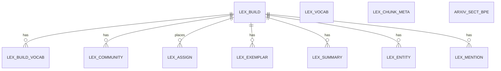

# Entity Model: Lexical Index

The keyword index of the corpus chunks: each build fixes a vocabulary and weights, stores every chunk as a weighted list of terms, and places papers in communities with summaries and entity mentions.

## Entity Relationship Diagram

### LEX_BUILD

One full build of the keyword index.

| Attribute | Description | Data Type | Length/Precision | Validation Rules |
|---|---|---|---|---|
| build_id | Unique identifier of the build | Long | 19 | Primary Key, Sequence |
| label | Index label the build belongs to | String | - | Not Null |
| created | When the build was created | DateTime | - | Not Null |
| live | Whether this build is the live one for its label | Boolean | - | Not Null |
| ready | Whether the build is complete | Boolean | - | Not Null |
| n_chunks | Number of chunks in the build | Integer | 10 | Not Null, Min: 0 |
| params | Settings the build was made with, as a JSON document | String | - | Not Null |

### LEX_VOCAB

The shared vocabulary of a label: one column per term, with its inverse document frequency.

| Attribute | Description | Data Type | Length/Precision | Validation Rules |
|---|---|---|---|---|
| label | Index label | String | - | Primary Key |
| col | Column number of the term | Integer | 10 | Primary Key |
| piece | Term or subword piece | String | - | Not Null |
| idf | Inverse document frequency of the term | Decimal | - | Optional |

#### Constraints

- Each term appears once per label.

### LEX_CHUNK_META

Metadata of each chunk the index holds, with its sparse-vector length and whether it was truncated.

| Attribute | Description | Data Type | Length/Precision | Validation Rules |
|---|---|---|---|---|
| label | Index label | String | - | Primary Key |
| build_id | Build the chunk belongs to | Long | 19 | Primary Key |
| ord | Position of the chunk | Integer | 10 | Primary Key |
| record_id | Unique record number of the chunk | Long | 19 | Not Null, Unique |
| doc_id | Identifier of the paper | String | - | Not Null |
| section_idx | Section number within the paper | Integer | 10 | Not Null |
| chunk_idx | Chunk number within the section | Integer | 10 | Not Null |
| section_title | Title of the section | String | - | Not Null |
| is_reference | Whether the chunk comes from a reference list | Boolean | - | Not Null |
| nnz | Number of non-zero terms in the chunk's vector | Integer | 10 | Not Null, Min: 0 |
| truncated | Whether the chunk's vector was cut to its heaviest terms | Boolean | - | Not Null |
| text | Text of the chunk | String | - | Not Null |

#### Constraints

- Each chunk appears once per label and build, keyed by paper, section and chunk number.

### ARXIV_SECT_BPE

The sparse vectors of the chunks, named after their label (the default label is the one chat retrieval reads).

| Attribute | Description | Data Type | Length/Precision | Validation Rules |
|---|---|---|---|---|
| ord | Position of the chunk | Integer | 10 | Primary Key |
| doc_id | Identifier of the paper | String | - | Not Null |
| source | Source the chunk came from | String | - | Optional |
| nnz | Number of non-zero terms in the vector | Integer | 10 | Not Null, Min: 0 |
| truncated | Whether the vector was cut to its heaviest terms | Boolean | - | Not Null |
| vec | Sparse vector of weighted terms | String | - | Not Null |

### LEX_BUILD_VOCAB

The vocabulary and inverse document frequencies of one build.

| Attribute | Description | Data Type | Length/Precision | Validation Rules |
|---|---|---|---|---|
| build_id | Build the term belongs to | Long | 19 | Primary Key, Foreign Key (LEX_BUILD.build_id) |
| col | Column number of the term | Integer | 10 | Primary Key |
| piece | Term or subword piece | String | - | Not Null, Unique |
| idf | Inverse document frequency of the term in this build | Decimal | - | Not Null |

### LEX_COMMUNITY

A community of papers within a build.

| Attribute | Description | Data Type | Length/Precision | Validation Rules |
|---|---|---|---|---|
| build_id | Build the community belongs to | Long | 19 | Primary Key, Foreign Key (LEX_BUILD.build_id) |
| cid | Community number within the build | Integer | 10 | Primary Key |
| size | Number of chunks in the community | Integer | 10 | Not Null, Min: 0 |
| centroid | Centre of the community's vectors, as a vector; empty when none was stored | String | - | Optional |

### LEX_ASSIGN

The community each chunk was placed in.

| Attribute | Description | Data Type | Length/Precision | Validation Rules |
|---|---|---|---|---|
| build_id | Build the placement belongs to | Long | 19 | Primary Key, Foreign Key (LEX_BUILD.build_id) |
| ord | Position of the chunk | Integer | 10 | Primary Key |
| cid | Community the chunk was placed in | Integer | 10 | Not Null |
| how | How the placement was made | String | - | Not Null, Values: consensus, nearest-centroid |
| x | Horizontal layout position; empty for nearest-centroid placements | Decimal | - | Optional |
| y | Vertical layout position; empty for nearest-centroid placements | Decimal | - | Optional |

### LEX_EXEMPLAR

The representative chunks of a community, in rank order.

| Attribute | Description | Data Type | Length/Precision | Validation Rules |
|---|---|---|---|---|
| build_id | Build the exemplar belongs to | Long | 19 | Primary Key, Foreign Key (LEX_BUILD.build_id) |
| cid | Community number | Integer | 10 | Primary Key |
| rank | Position of the exemplar in its community | Integer | 10 | Primary Key |
| role | Why this chunk was picked, such as the medoid or a pick | String | - | Not Null |
| z | Score of the chunk on its community's scale | Decimal | - | Not Null |
| ord | Position of the chunk | Integer | 10 | Not Null |

### LEX_SUMMARY

The drafted summary of a community, with the model that wrote it.

| Attribute | Description | Data Type | Length/Precision | Validation Rules |
|---|---|---|---|---|
| build_id | Build the summary belongs to | Long | 19 | Primary Key, Foreign Key (LEX_BUILD.build_id) |
| cid | Community number | Integer | 10 | Primary Key |
| status | Whether the summary is a draft, failed, or was not produced | String | - | Not Null, Values: draft, failed, not_summarized |
| title | Short title of the community | String | - | Optional |
| summary | Drafted summary, labelled as a machine draft | String | - | Optional |
| model | Model that wrote the summary | String | - | Optional |
| provider | Provider that served the model | String | - | Optional |
| prompt_tokens | Input length of the request | Integer | 10 | Optional |
| completion_tokens | Output length of the reply | Integer | 10 | Optional |
| cost | Cost of the request as reported by the provider | Decimal | - | Optional |
| chunk_keys | Keys of the chunks the summary was drafted from, as a JSON document | String | - | Not Null |

### LEX_ENTITY

An entity derived from the corpus, with its counts across papers.

| Attribute | Description | Data Type | Length/Precision | Validation Rules |
|---|---|---|---|---|
| build_id | Build the entity belongs to | Long | 19 | Primary Key, Foreign Key (LEX_BUILD.build_id) |
| ent_id | Identifier of the entity within the build | Integer | 10 | Primary Key |
| fold | Folded form of the surface, used for matching | String | - | Not Null |
| surface | Surface form as it appears in the text | String | - | Not Null |
| n | Number of words in the surface | Integer | 5 | Not Null |
| score | Score of the entity on the derivation scale | Decimal | - | Not Null |
| df_papers | Number of papers that mention the entity | Integer | 10 | Not Null |
| df_chunks | Number of chunks that mention the entity | Integer | 10 | Not Null |
| tf | Total number of mentions | Integer | 10 | Not Null |
| canonical | Canonical marker stored by the entity step | Integer | 10 | Not Null |

### LEX_MENTION

How often each entity is mentioned in each chunk.

| Attribute | Description | Data Type | Length/Precision | Validation Rules |
|---|---|---|---|---|
| build_id | Build the mention belongs to | Long | 19 | Primary Key, Foreign Key (LEX_BUILD.build_id) |
| ord | Position of the chunk | Integer | 10 | Primary Key |
| ent_id | Entity mentioned | Integer | 10 | Primary Key |
| cnt | Number of mentions in the chunk | Integer | 10 | Not Null |
