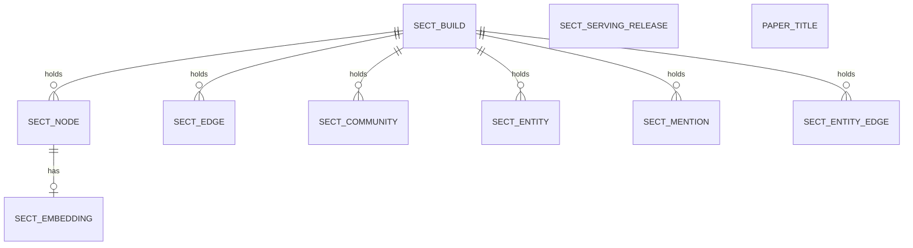

# Entity Model: Section Map

The section builds of the papers: each build holds its sections, the similarity connections between them, their communities, the entities they mention, and the paper titles.

## Entity Relationship Diagram

### SECT_BUILD

One section build under a tag.

| Attribute | Description | Data Type | Length/Precision | Validation Rules |
|---|---|---|---|---|
| build_id | Unique identifier of the build | Long | 19 | Primary Key, Sequence |
| tag | Tag the build was made under | String | - | Not Null |
| created_at | When the build was created | DateTime | - | Not Null |
| live | Whether this is the live build for its tag | Boolean | - | Not Null |
| n_nodes | Number of sections in the build | Integer | 10 | Optional |
| n_edges | Number of connections in the build | Integer | 10 | Optional |
| n_communities | Number of communities in the build | Integer | 10 | Optional |
| params | Settings the build was made with, as a JSON document | String | - | Not Null |

### SECT_NODE

One section of a paper.

| Attribute | Description | Data Type | Length/Precision | Validation Rules |
|---|---|---|---|---|
| build_id | Build the section belongs to | Long | 19 | Primary Key, Foreign Key (SECT_BUILD.build_id) |
| ord | Position of the section in the build | Integer | 10 | Primary Key |
| record_id | Unique record number used by the vector and keyword indexes | Long | 19 | Not Null, Unique |
| doc_id | Identifier of the paper | String | - | Not Null |
| section_idx | Position of the section within its paper | Integer | 10 | Not Null |
| section_title | Heading of the section | String | - | Optional |
| community | Community the section belongs to | Integer | 10 | Not Null |
| x | Horizontal layout position | Decimal | - | Optional |
| y | Vertical layout position | Decimal | - | Optional |
| genre_frac | Share of the section's vector along the genre axes | Decimal | - | Optional |
| text | Whole text of the section | String | - | Not Null |
| tsv | Full-text search representation of the section | String | - | Optional |

### SECT_EMBEDDING

The dense vectors of a section, stored apart from the section record.

| Attribute | Description | Data Type | Length/Precision | Validation Rules |
|---|---|---|---|---|
| record_id | Section the vectors belong to | Long | 19 | Primary Key, Foreign Key (SECT_NODE.record_id) |
| emb | Dense vector of the section, 256 dimensions | String | - | Not Null |
| emb_b | Dense vector with the genre axes removed, 256 dimensions; empty when not computed | String | - | Optional |

### SECT_EDGE

A similarity connection between two sections of a build, with the scores that produced it.

| Attribute | Description | Data Type | Length/Precision | Validation Rules |
|---|---|---|---|---|
| build_id | Build the connection belongs to | Long | 19 | Primary Key, Foreign Key (SECT_BUILD.build_id) |
| a | Earlier section of the pair | Integer | 10 | Primary Key |
| b | Later section of the pair | Integer | 10 | Primary Key |
| weight | Strength of the connection, the average significance of the kinds that found it | Decimal | - | Not Null |
| dense_sim | Similarity by meaning | Decimal | - | Optional |
| dense_z | Significance of the similarity by meaning | Decimal | - | Optional |
| sparse_sim | Similarity by shared wording | Decimal | - | Optional |
| sparse_z | Significance of the similarity by shared wording | Decimal | - | Optional |
| sig | Bit set of the kinds whose significance found the connection | Integer | 5 | Not Null |
| backbone | Bit set of the kinds that kept it as one of the section's strongest neighbours | Integer | 5 | Not Null |

#### Constraints

- Each pair is stored once with the earlier section first.

### SECT_COMMUNITY

A community of sections within a build.

| Attribute | Description | Data Type | Length/Precision | Validation Rules |
|---|---|---|---|---|
| build_id | Build the community belongs to | Long | 19 | Primary Key, Foreign Key (SECT_BUILD.build_id) |
| cid | Community number within the build | Integer | 10 | Primary Key |
| size | Number of sections in the community | Integer | 10 | Not Null, Min: 0 |
| genre_score | Score of the community on the genre axes | Decimal | - | Optional |
| genre_flag | Whether the community is flagged as a genre cluster | Boolean | - | Not Null |
| title | Title of the community | String | - | Optional |
| summary | Drafted summary, labelled as a machine draft | String | - | Optional |
| status | Status of the community's draft | String | - | Optional |
| terms | Distinctive terms of the community with their scores, as a JSON document | String | - | Optional |
| emb | Vector of the community's summary | String | - | Optional |
| entities | Entities the community mentions most, as a JSON document | String | - | Optional |

### SECT_ENTITY

An entity derived from the corpus within a build.

| Attribute | Description | Data Type | Length/Precision | Validation Rules |
|---|---|---|---|---|
| build_id | Build the entity belongs to | Long | 19 | Primary Key, Foreign Key (SECT_BUILD.build_id) |
| ent_id | Identifier of the entity within the build | Integer | 10 | Primary Key |
| surface | Surface form of the entity | String | - | Not Null |
| n | Number of words in the surface | Integer | 5 | Not Null |
| df | Number of sections that mention the entity | Integer | 10 | Not Null |

### SECT_MENTION

How often each entity is mentioned in each section.

| Attribute | Description | Data Type | Length/Precision | Validation Rules |
|---|---|---|---|---|
| build_id | Build the mention belongs to | Long | 19 | Primary Key, Foreign Key (SECT_BUILD.build_id) |
| ord | Position of the section | Integer | 10 | Primary Key |
| ent_id | Entity mentioned | Integer | 10 | Primary Key |
| cnt | Number of mentions in the section | Integer | 10 | Not Null |

### SECT_ENTITY_EDGE

A link between two entities that occur together in a build.

| Attribute | Description | Data Type | Length/Precision | Validation Rules |
|---|---|---|---|---|
| build_id | Build the link belongs to | Long | 19 | Primary Key, Foreign Key (SECT_BUILD.build_id) |
| a | Earlier entity of the pair | Integer | 10 | Primary Key |
| b | Later entity of the pair | Integer | 10 | Primary Key |
| kind | Kind of link | String | - | Primary Key, Values: co_mention |
| n_shared | Number of sections both entities occur in | Integer | 10 | Not Null |
| npmi | Normalised pointwise mutual information of the pair | Decimal | - | Not Null |

#### Constraints

- Each pair is stored once with the earlier entity first.

### SECT_SERVING_RELEASE

The pair of generations the retrieval service serves: one section build and one keyword generation, published together.

| Attribute | Description | Data Type | Length/Precision | Validation Rules |
|---|---|---|---|---|
| tag | Tag of the served release | String | - | Primary Key |
| graph_build_id | Section build served | Long | 19 | Not Null |
| bm25_label | Keyword index label served | String | - | Not Null |
| bm25_build_id | Keyword index build served | Long | 19 | Not Null |
| published_at | When the pair was published | DateTime | - | Not Null |

### PAPER_TITLE

The title of each paper, stored once.

| Attribute | Description | Data Type | Length/Precision | Validation Rules |
|---|---|---|---|---|
| arxiv_id | arXiv identifier of the paper, without its version | String | - | Primary Key |
| title | Title of the paper | String | - | Not Null |
| thesis | Thesis sentence from the paper's listing, when available | String | - | Optional |
| source | Where the title came from | String | - | Not Null |
| loaded_at | When the title was stored | DateTime | - | Not Null |
